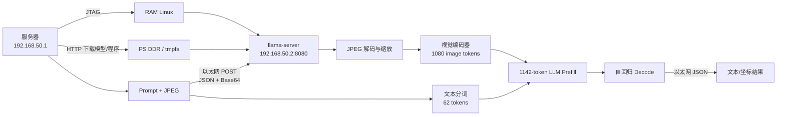

# RoboBrain2.5-4B 在 ZCU102 PS 端的部署与性能验证

> PPT 绘制建议：16:9；每页只保留一个核心结论；公式与结果数字加粗；统一使用蓝灰色学术风格。

---

## 第 0 页｜标题页

**RoboBrain2.5-4B 在 Xilinx ZCU102 上的本地部署与推理验证**

- 部署平台：Zynq UltraScale+ MPSoC / ZCU102
- 当前阶段：PS 端 CPU-only 基础功能验证
- 验证任务：文字交互、图像 affordance 坐标预测

**配图建议：** ZCU102 实物图 + “Server—Ethernet—ZCU102”简图。

---

## 第 1 页｜硬件平台与资源条件

| 项目 | 配置 |
|---|---|
| SoC | Xilinx Zynq UltraScale+ MPSoC |
| PS CPU | 4× Arm Cortex-A53，**1.19988 GHz** |
| SIMD | Armv8-A NEON；无 INT8 Dot Product / I8MM |
| Cache | 每核 32 KB I-Cache + 32 KB D-Cache；共享 1 MB L2 |
| DDR4 | 16 GB Micron DDR4-2666 SODIMM |
| 实际 DDR 配置 | **DDR4-2133，64-bit，理论 17.065 GB/s** |
| Linux 可用内存 | MemTotal 约 **13.65 GiB**；无 Swap |
| 网络 | PS 端千兆以太网 |

**核心结论：** 16 GB DDR 足以容纳 Q8 主模型和视觉投影模型；主要限制来自 A53 计算能力，而非容量。

**配图建议：** ZCU102 PS/PL 结构图；突出 A53、DDR4、GEM 三个模块。

---

## 第 2 页｜模型来源与 Q8_0 量化格式

### 模型来源

| 项目 | 内容 |
|---|---|
| 原始模型 | BAAI 官方 `RoboBrain2.5-4B`，Qwen3-VL 架构，原始权重为 BF16 |
| GGUF 发布者 | `mradermacher/RoboBrain2.5-4B-GGUF`，**第三方转换，非 BAAI 官方 GGUF** |
| 固定版本 | revision `a43f8ba7a3499579a8f43258ea36af018f26a17c` |
| 主模型 | `RoboBrain2.5-4B.Q8_0.gguf`，4.693 GB，SHA-256 已校验 |
| 视觉模型 | `RoboBrain2.5-4B.mmproj-Q8_0.gguf`，0.454 GB，SHA-256 已校验 |

### GGML Q8_0 标准

- 对权重按 **32 个数一组**进行对称量化，零点固定为 0。
- 每组保存：32×INT8 权重 + 1×FP16 scale，共 34 byte。
- 平均存储位宽：

\[
34\times8/32=\mathbf{8.5\ bit/weight}
\]

\[
d=\max(|x|)/127,\qquad q_i=\operatorname{round}(x_i/d),\qquad \hat{x}_i=dq_i
\]

**计算口径：** 这是 GGML/llama.cpp 的 Q8_0 分块权重量化；Norm、Bias 和部分张量仍为 FP32。运行时部分激活会动态量化参与点积，因此不能简单等同于全图固定 W8A8。

**核心目的：** 将主模型与视觉模型压缩至约 5.15 GB，使其能够完整驻留 16 GB DDR。

---

## 第 3 页｜部署架构与完整推理流程

### 部署阶段

1. JTAG 将 Linux、设备树和 initramfs 加载到 DDR；不依赖 SD 卡写入。
2. PS 端配置静态地址 `192.168.50.2/24`，服务器端为 `192.168.50.1/24`。
3. 板端通过 PS 以太网从服务器下载模型和 ARM64 `llama-server`。
4. 文件写入 DDR 中的 `/dev/shm/robobrain`；完成 SHA-256 校验后使用 `mlock` 锁定。
5. 4 核 A53 启动 CPU-only `llama-server`，开放 OpenAI-compatible API。

### 单次推理阶段

1. 服务器读取 Prompt；图片任务同时读取 JPEG，并编码为 Base64 Data URI。
2. 通过以太网向 `/v1/chat/completions` 发送 JSON；文字任务只携带 Prompt。
3. 板端解析请求：JPEG 解码、双线性缩放至 `1280×864`，视觉编码得到 1080 token。
4. Prompt 分词得到 62 个文本/特殊 token，与图像 token 组成 1142-token 序列。
5. A53 执行 36 层 LLM Prefill，在 DDR 中建立 KV Cache；随后逐 token Decode。
6. `llama-server` 将文本或坐标封装为 JSON，经以太网返回服务器。

### 关键运行参数

`ctx=2048`　`batch=2048`　`ubatch=512`　`threads=4`　`parallel=1`

**系统特性：** 模型与系统均驻留 DDR；复位或掉电后运行环境消失，需要重新加载。

---

## 第 4 页｜文字推理理论计算

### 模型结构

- 36 层 Transformer；隐藏维度 2560；FFN 维度 9728
- 32 个 Query Head、8 个 KV Head；Head Dimension = 128
- 每层每 token：

\[
C_{layer}=100.92544\ \text{M MAC}
\]

### 代表性测试：18 个输入 token + 2 个输出 token

| 部分 | 等效运算量 |
|---|---:|
| Prompt 预填充 | 130.90 GOP |
| 生成 2 token | 16.11 GOP |
| 合计 | **147.01 GOP** |

### 理论时间

FP32 NEON 峰值参考：

\[
4\times1.19988\ \text{GHz}\times8=38.396\ \text{GFLOP/s}
\]

\[
T_{FP32-ref}=147.01/38.396=\mathbf{3.83\ s}
\]

A53 无 INT8 Dot Product，Q8_0 需要乘法扩展、归约和缩放：

\[
T_{Q8,ideal}\ge\mathbf{5.74\ s}
\]

**说明：** 以上为理想参考/放宽下界；实际时间还受权重访存、动态量化、Cache miss 和线程同步影响。

**配图建议：** 左侧放模型参数，右侧放“运算量→理论吞吐→理论时间”三级公式。

---

## 第 5 页｜图片推理理论计算

### 图像 token 化

原图 `640×426`，`patch=16`，空间合并 `2×2`：

\[
640\times426\rightarrow1280\times864
\]

\[
N_{patch}=80\times54=4320
\]

\[
N_{image}=40\times27=\mathbf{1080\ tokens}
\]

最终 Prompt：1080 个图像 token + 62 个文本/特殊 token = **1142 token**。

### 主运算量

| 阶段 | 等效运算量 |
|---|---:|
| 视觉编码器（24层） | 4.693 TOP |
| 语言模型 Prompt | 8.683 TOP |
| 生成 11 token | 0.096 TOP |
| 合计 | **13.472 TOP** |

### 理论时间

\[
T_{FP32-ref}=13.472/38.396=350.9\ s=\mathbf{5.85\ min}
\]

考虑 A53 的 Q8_0 fallback 指令序列：

\[
T_{kernel,ideal}\ge\mathbf{8.3\ min}
\]

若持续等效吞吐为 6.5–11 GOP/s，则工程估算约 **20–35 min**。

**重点：** 图像推理时间主要来自视觉编码和 1142-token Prompt 预填充；Flash Attention 降低内存占用，但不消除主要乘加运算。

---

## 第 6 页｜实测结果

### 文字推理

| 输入 | 输出 | Token 数（输入/输出） | 端到端时间 |
|---|---|---:|---:|
| `Reply with only the word OK.` | `OK` | 15 / 2 | **14.084 s** |
| “天空通常是什么颜色？” | `蓝色` | 18 / 2 | **14.097 s** |
| `What is 1+1?` | `2` | 21 / 2 | **16.739 s** |
| 重复 Prompt（命中缓存） | `OK` | 15 / 2 | **2.086 s** |

### 图片 affordance 推理

| 指标 | 实测值 |
|---|---:|
| 输出坐标 | `[(920, 548)]` |
| Prompt | 1142 token |
| 输出 | 11 token |
| Prompt/图像处理 | **1709.905 s** |
| 文本生成 | **15.436 s** |
| 端到端 | **1725.623 s（28 min 45.6 s）** |
| Prompt 吞吐 | 0.668 token/s |
| 生成吞吐 | 0.713 token/s |

**验证结果：** 文本输出正确；坐标格式有效，并接近服务器 CPU 参考结果；推理过程中服务保持在线。

**图表建议：** 文字测试用柱状图；图片测试用堆叠条形图，突出 Prompt 阶段占比。

---

## 第 7 页｜性能分析与瓶颈定位

- 图片 Prompt/视觉阶段占服务端总时间约 **99.1%**。
- 4 个 Cortex-A53 核持续满载；推理期间仍有 7 GiB 以上可用内存。
- 端到端与服务端计时仅相差约 **0.281 s**：以太网不是主要瓶颈。
- 16 GB DDR 容量充足；DDR 带宽影响生成阶段，但不是 28 分钟延迟的主因。
- 实测等效吞吐：

\[
13.472\ \text{TOP}/1725.342\ \text{s}=\mathbf{7.81\ GOP/s}
\]

- 相当于 38.396 GFLOP/s FP32 峰值参考的约 **20.3%**。

**瓶颈排序：** A53 Q8 矩阵计算 ＞ 长图像 Prompt ＞ Cache/DDR 访问 ＞ 网络通信。

**配图建议：** 瓶颈占比饼图或横向排序图。

---

## 第 8 页｜结论与后续工作

### 当前结论

- 完成 RoboBrain2.5-4B Q8 模型在 ZCU102 16 GB DDR 中的完整加载。
- 完成 PS 端以太网文字交互和单图 affordance 坐标推理。
- 验证结果正确，但图片推理延迟约 28.8 min，CPU 是核心瓶颈。
- 当前实现尚未使用 PL 端计算资源，属于部署可行性基线。

### 后续工作

1. 分离记录视觉编码、LLM Prefill 和 Decode 的板端时间。
2. 在不改变模型权重的前提下，优化 ARM kernel、线程调度和内存布局。
3. 评估降低图像 token 数对坐标精度与速度的影响。
4. 将 Q8 矩阵乘法或视觉注意力迁移至 PL，保留现有以太网 API 与软件流程。

**最终结论：** 已证明“模型驻留 DDR + PS 端 CPU 推理 + 以太网交互”的完整链路可行；下一阶段应围绕视觉 Prompt 计算进行 PL 加速。

---

## 附录｜数据口径与引用来源

- 模型：RoboBrain2.5-4B，Q8_0 主模型 + Q8_0 mmproj。
- 原始模型：`BAAI/RoboBrain2.5-4B`；GGUF：`mradermacher/RoboBrain2.5-4B-GGUF`，非官方量化发布。
- Q8_0 定义：32 个 INT8 + 1 个 FP16 scale/块，即 8.5 bit/weight。
- llama.cpp：commit `178a6c44937154dc4c4eff0d166f4a044c4fceba`。
- 实测记录：`deployment/reports/2026-07-21_robobrain4b_zcu102_acceptance.md`。
- 板端日志：`deployment/reports/2026-07-21-zcu102-runtime-vision-batch2048.log`。
- 模型配置：[BAAI/RoboBrain2.5-4B config.json](https://huggingface.co/BAAI/RoboBrain2.5-4B/blob/main/config.json)。
- 所有 TOP/GOP 均为“1 MAC = 2 次等效运算”的模型主矩阵运算口径，不等同于实际 CPU 指令数。
