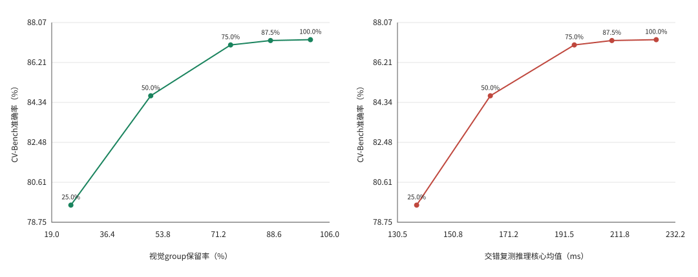

# L2 Token裁剪的保留率曲线

## 实验做了什么

保持同一模型、Prompt、图像、16 Token生成上限和选择器，只改变保留率。前6个视觉块不裁剪，在第5层后按完整2×2 group筛选；后续视觉层、DeepStack、Merger和LLM视觉序列同时压紧，保留原位置。
L2评分是每个patch隐藏向量的平方和开方，再对group内4个patch取平均。3×3锚点是把空间网格分为最多9个区域，每区保留最高分group，再用全局高分group填满预算。预算向上取整，因此实际保留率可能略高于设定。
全部2638题按CV-Bench官方来源组合公式计分，解析失败算错误。没有新建统一通过门槛，没有根据结果调整选择器；95%配对置信区间用于描述差异，不表示已证明非劣。

组合公式为0.5×[(ADE20K准确率+COCO准确率)/2+Omni3D准确率]，不是直接用全部题目的正确率。本汇总用5000次分层配对bootstrap、多项分布抽样计算区间；单档报告用逐条重采样，有限次随机模拟会使区间端点略有不同，不影响点估计或本轮结论。

## 完整集准确率

| 保留率 | 官方组合分数 | 相对Dense变化（百分点） | 差值95% CI（百分点） | 分数相对保留 | 正确→错误 / 错误→正确 |
|---:|---:|---:|---:|---:|---:|
| 100.0% | 87.2730% | +0.0000 | [+0.0000, +0.0000] | 100.0000% | 0 / 0 |
| 87.5% | 87.2335% | -0.0395 | [-0.4544, +0.3754] | 99.9547% | 18 / 17 |
| 75.0% | 87.0276% | -0.2454 | [-0.7845, +0.2993] | 99.7188% | 33 / 27 |
| 50.0% | 84.6532% | -2.6198 | [-3.5187, -1.6923] | 96.9981% | 121 / 48 |
| 25.0% | 79.5486% | -7.7244 | [-8.9513, -6.5058] | 91.1492% | 263 / 51 |

| 保留率 | Count | Relation | Depth | Distance | 解析成功率 |
|---:|---:|---:|---:|---:|---:|
| 100.0% | 68.2741% | 94.7692% | 98.1667% | 91.1667% | 98.4837% |
| 87.5% | 68.6548% | 94.1538% | 98.1667% | 91.1667% | 98.2563% |
| 75.0% | 67.8934% | 94.3077% | 98.3333% | 91.0000% | 98.3321% |
| 50.0% | 62.3096% | 91.8462% | 97.3333% | 90.8333% | 98.4837% |
| 25.0% | 52.4112% | 89.8462% | 92.8333% | 87.3333% | 98.9765% |

| 保留率 | 全部解析失败 | 达到16 Token上限 | Dense正确→未解析 | Dense正确→解析后答错 |
|---:|---:|---:|---:|---:|
| 100.0% | 40 | 40 | 0 | 0 |
| 87.5% | 46 | 46 | 1 | 17 |
| 75.0% | 44 | 44 | 0 | 33 |
| 50.0% | 40 | 40 | 2 | 119 |
| 25.0% | 27 | 27 | 3 | 260 |

达到Token上限不必然表示答案被截断；这只是排查线索。所有配置使用同一16 Token上限，若某档解析失败明显增多，需要另设固定的长输出对照实验，不能只靠此表断言视觉信息丢失。

## 交错重复时延

固定100题，各配置预热5次，每题3次正式重复，按题与重复轮次旋转配置顺序。以下数字来自同一运行的交错复测，不拿完整准确率扫描中不同时间的GPU状态比较加速比。
| 保留率 | 核心均值 ms | p50 ms | p95 ms | 均值加速比 | Vision均值 ms | Prefill均值 ms | 平均输出Token |
|---:|---:|---:|---:|---:|---:|---:|---:|
| 100.0% | 225.161 | 160.355 | 354.813 | 1.000× | 57.958 | 93.925 | 4.240 |
| 87.5% | 208.930 | 159.559 | 321.399 | 1.078× | 52.205 | 83.706 | 4.240 |
| 75.0% | 195.189 | 156.231 | 292.367 | 1.154× | 47.524 | 75.038 | 4.240 |
| 50.0% | 164.468 | 138.061 | 234.184 | 1.369× | 38.132 | 54.539 | 4.230 |
| 25.0% | 137.507 | 126.796 | 178.509 | 1.637× | 29.272 | 36.933 | 4.240 |

时延只包含推理核心，不含processor、H2D与图片解码；未测GPU功耗，也不是ZCU102或目标异构平台结果。输出长度变化会影响核心时延，因此同时列出输出Token，不能把全部时间差都归于矩阵工作量减少。

## 定位诊断

定位诊断方案使用已公开96张COCO图片，每图Grounding和Pointing各一条，共192条。真值框来自COCO，Pointing真值为框中心，不是人工标注的抓取可供性点。该集合只做误差归因，不作为新盲测，也不与CV-Bench加权合成分数。
PCK@0.1/0.2：预测点与真值的距离不超过目标框对角线的10%/20%时计正确。Mean IoU：预测框与真值框交集面积除以并集面积的平均值。Acc@0.5：IoU至少0.5的比例。格式失败均计为错误。

| 保留率 | PCK@0.1 | PCK@0.2 | Mean IoU | Acc@0.5 |
|---:|---:|---:|---:|---:|

本次分档定位诊断尚未执行，表中不填估算值；上述段落说明计划使用的集合和指标，不是已完成实验。CV-Bench选择题结果不能替代精细定位验证。

## 计算量与可宣称范围

| 保留率 | 实际Token保留 | Vision MAC代理保留 | Prefill MAC代理保留 |
|---:|---:|---:|---:|
| 100.0% | 100.0000% | 100.0000% | 100.0000% |
| 87.5% | 87.6002% | 88.6789% | 87.0766% |
| 75.0% | 75.0338% | 77.7990% | 74.1340% |
| 50.0% | 50.0167% | 57.8748% | 48.8164% |
| 25.0% | 25.0276% | 40.2912% | 24.1272% |

MAC代理只覆盖主要Transformer矩阵计算，排除patch embedding、Merger、DeepStack投影和文本Token。完整CV-Bench已用于观察固定曲线，后续不得把在此集合上选出的新策略称为未观察盲测。其他官方空间基准、通用VLM鲁棒性及真实Q8_0复验仍未完成；本次结果不能解除此前强裁剪定位退化的结论，也不授权Selector RTL或板端部署。

## 当前结论

75%保留率的CV-Bench得分较Dense下降0.2454个百分点，推理核心均值加速约1.154倍，是本轮值得继续验证的低损失候选；差值置信区间包含零，不等于证明无损或统计非劣。
50%与25%保留率分别下降2.6198和7.7244个百分点，差值置信区间均完全为负；对应核心加速约1.369和1.637倍。这是明确的质量—性能交换，不是全部方案都通过精度验证。
100题时延集合各档平均输出约4.24 Token，输出长度接近；在这个集合中，收益与视觉和Prefill工作量减少一致。是否适用于精细空间定位、真实Q8后端和目标异构平台，还需独立验证。

